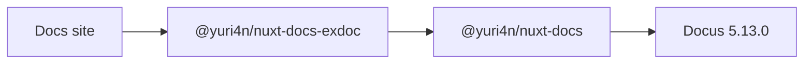

Write a `mermaid` code fence. The docs layer draws it in the browser with
the colors and the font of the site. A click on the diagram opens a zoom
lightbox: the mouse wheel zooms, a drag pans, and Escape closes it.

_Figure 1 — The layers of this site: the site extends the exdoc layer, which
extends the docs layer, which extends Docus. AI generated._

A caption is an italic-only paragraph directly below the figure. The docs
layer styles it: small, centered and muted.
